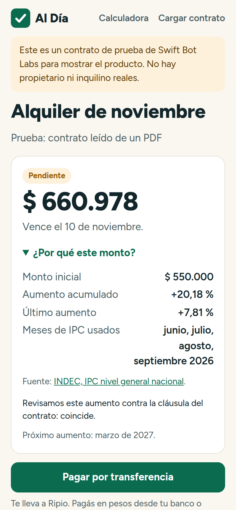
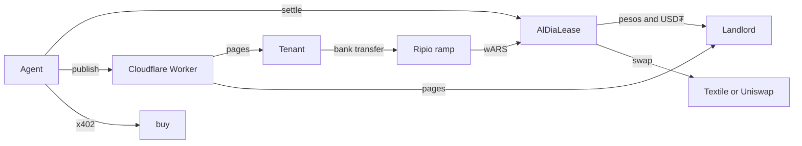

# Al Día

**Rent that updates and collects itself, in pesos, on Celo mainnet.**

A small landlord in Argentina loads a rental contract once. Every month the agent works out the rent from the official index, the tenant pays by ordinary bank transfer, and the money lands as wARS in a contract that can only pay the landlord. The agent then reconciles the payment, moves the share the landlord chose into USD₮ at the better of Textile FX and Uniswap, and issues the receipt.

Live: **https://aldia.swiftbotlab.workers.dev** (in Argentine Spanish, built for a phone)

Demo video: **https://youtu.be/DmCQoeQxLME** (1:34)



## Who it is for

Picture a typical case: Graciela owns one flat in Almagro and rents it out. Her contract says the rent moves every four months with INDEC's IPC. So every four months she looks up the prints, multiplies, messages the tenant, watches her bank app for the transfer, writes a receipt, and, if she wants to protect the money, goes and buys dollars herself. She does this by hand, and the number is hers to defend if the tenant asks.

Her tenant wants to know how much she owes this month and why. She should not have to learn what a stablecoin is.

Al Día does the landlord's chore and shows the tenant the working. Graciela is an example, not a customer. Indexed rent is a Latin American habit, not only an Argentine one (Chile's UF, Brazil's IGP-M and IPCA, Colombia's annual IPC), so the same agent extends to wBRL once its liquidity on Celo can carry it.

## What the agent does on its own

| Step | What happens | Where |
|---|---|---|
| Reads official data | Pulls IPC from INDEC and ICL from the BCRA, and checks INDEC against the Ministry of Economy series and BCRA variable 27. If they disagree it issues no new adjustment. | [`agent/indices.py`](agent/indices.py) |
| Reads the contract | A PDF is turned into text on the landlord's phone with DNI, CUIT, CBU, mail and phone removed. A paid model call finds the amount, dates, index and clause. The landlord confirms every field. | [`agent/reader.py`](agent/reader.py), `web/app.js` |
| Computes the rent | Exact arithmetic, with the months and index levels shown to both sides. | [`agent/rent.py`](agent/rent.py) |
| Audits each increase | When a rent goes up and the agent holds the clause, a paid model call checks the increase against that clause. | `check_clause` in `agent/reader.py` |
| Watches for the money | Sees wARS arrive at the lease address, matches it to the month, accepts up to 2% short (Ripio can deliver slightly under), and marks partial payments. | [`agent/loop.py`](agent/loop.py) |
| Converts and pays | Gets a firm Textile quote with the lease contract as taker, compares it with Uniswap, and settles in one transaction. | [`agent/lease_ops.py`](agent/lease_ops.py) |
| Tells people | Telegram notices: bill issued, three days to go, due today, late, paid. | [`agent/notify.py`](agent/notify.py) |

## What the agent cannot do

Each lease is its own contract, [`AlDiaLease`](contracts/src/AlDiaLease.sol). These rules hold even if the agent's key is stolen. The price floor has one limit, explained in [SECURITY.md](SECURITY.md):

- `settle` can pay only the landlord and a fee capped at 1%. There is no recipient parameter.
- A swap must return at least the higher of the Uniswap 30-minute and 4-hour TWAPs, less the landlord's slippage limit. The contract computes that floor, not the agent. If the market really falls fast, the floor stays above it for a while and the landlord gets pesos that month.
- The dollar share belongs to the landlord. The agent can skip a swap, never raise the share.
- The landlord can withdraw everything or remove the agent at any time.
- The ERC-1271 signature check accepts one message only: Textile's taker-control text for that contract.

## Five-minute path for judges

1. **Use it with no wallet.** Open the [calculator](https://aldia.swiftbotlab.workers.dev/calculadora), enter a rent and a start date, and read which months of IPC were used.
2. **See what a tenant sees.** [A rent raised by IPC](https://aldia.swiftbotlab.workers.dev/pagar/c658d0b11729). This one was loaded from a PDF and audited against its clause.
3. **See a receipt.** [ICL rent settled through Textile](https://aldia.swiftbotlab.workers.dev/recibo/8650326827d3/2026-11), with the payment and settlement transactions linked.
4. **See who really used it.** The [transparency page](https://aldia.swiftbotlab.workers.dev/transparencia) separates our tests from real use.
5. **Create a lease.** [Cargar contrato](https://aldia.swiftbotlab.workers.dev/nuevo) takes about a minute. The agent creates the on-chain account only when the first payment arrives, so an unused lease costs nothing.
6. **Pay a real rent yourself.** [Probar](https://aldia.swiftbotlab.workers.dev/probar?lang=en) (Spanish, with an English version): enter your Celo address and pay a 1,000 wARS (about US$0.60) test rent in about two minutes. Your address is the landlord, so 997 wARS come back to you, less the 0.3% fee. It runs through the same lease contract, agent and receipt as a real rent.
7. **Read it without a browser.** Every public page is rendered on the server, so `curl` shows the same numbers and transaction links as the app. [/llms.txt](https://aldia.swiftbotlab.workers.dev/llms.txt) is a plain-text summary with the steps to check each claim on chain.

## Where users and volume came from

> [!IMPORTANT]
> **No independent user has paid through Al Día yet.** Every lease and payment listed below is a builder test: we funded the payments from our own agent wallet, and those leases carry a test label on the site. Nothing here is presented as customer volume. The transparency page counts an outside payer only after an automatic check on Celo's public explorer (Blockscout): the payment came straight from a wallet that is not ours, whose first funds did not come from one of our wallets, and whose first Celo activity is before 6 October 2026, the hackathon's independent-user rule. Anything that cannot be proven is not counted, and payments that fail the check are listed with the reason. Payers from the open test at `/probar` are labelled "fellow hackathon builder" when we cannot tell who they are.

| Test | Rent | What it proves | Payment | Settlement |
|---|---|---|---|---|
| First cycle | 4,000 wARS | Full cycle: 12 fee, 1,994 pesos, 1.21 USD₮ via Uniswap | [`0x438b…`](https://celoscan.io/tx/0x438b11f40a7303ac05a6710c2005ed07c2c431ea425fcfd5f1c1ab1d5932d4af) | [`0x9479…`](https://celoscan.io/tx/0x947955cd7b31aad7c2d64e1df1648c0ecb53c6046ed92c3bf0e2db300a0cd341) |
| IPC rent | 2,102 wARS | 1,700 raised by official IPC (+23.64%), all to dollars | [`0xe6de…`](https://celoscan.io/tx/0xe6de665bcfcaf4af4ec24175a2f1f636f7779562087f48c5a5e08028d01137db) | [`0xf248…`](https://celoscan.io/tx/0xf24844e388a5955fc860d16d2d9ba8ab5d89da3d62cfc91dbc873e31e15dec80) |
| ICL rent | 1,859 wARS | Textile route with the lease contract as taker | [`0xa363…`](https://celoscan.io/tx/0xa363761b8edde783e07770829a6758f105d63594ede8d42951966148a5bb56c6) | [`0x59a3…`](https://celoscan.io/tx/0x59a313d4c5e265d402189ea46cdd41e3ac362033da57fc00df88bfd62bded6e6) |
| Current factory | 1,000 wARS | The two-window floor on mainnet: 3 fee, 498 pesos, 0.30 USD₮ via Uniswap | [`0x786a…`](https://celoscan.io/tx/0x786a56c5ad24247919cc1ec80c1f5064513dba80cb1b0192b9992c7c3af543a0) | [`0x502f…`](https://celoscan.io/tx/0x502f68f20c46b3c3ba3d013490dab9b4893a61713940157188d92c3ed704ac04) |

In the third test we told the agent to take Textile even though Uniswap was a little better (1.124876 against 1.125160 USD₮), to prove the route. Without that instruction it takes the better price.

The fourth rent went through Uniswap even though Textile previewed a little better, because its sweep was under Textile's $1 minimum. Across the four rents the agent paid 8,961 wARS of our own money through the system.

The tenant path through Ripio's ramp link is built, but we have not completed it end to end: it needs an Argentine account and Ripio's KYC, which we do not have. Our tests pay wARS directly.

## Celo stack

| Piece | Use |
|---|---|
| wARS (Ripio) | The currency of the rent, from the tenant to the landlord |
| ERC-8004 | Agent [10014](https://8004scan.io/agents/celo/10014), [registered](https://celoscan.io/tx/0x543f492bbc821a75df02aaedebece12850d6dd083718bfa249018cee63d21016) from the agent wallet as its first transaction |
| ERC-8021 | Tag `celo_2ee02704a56d` on every transaction the agent sends, and on wallet payments made from the tenant page. [`agent/celo.py`](agent/celo.py) is the only path to the chain and refuses to sign anything untagged. Transfers that Ripio sends cannot carry our tag. |
| x402 | The agent pays for inference over x402 through [buy](https://usebuy.ai) with an EIP-3009 signature |
| Textile FX | RFQ taker through ERC-1271, keyless |
| Stablecoin gas | CIP-64 is implemented and [tested once](https://celoscan.io/tx/0x8c67010e073adace6180efd6c3358d26a9f7637c12847ecc0479a6d806407957). It is switched off in normal running. |
| MiniPay | The tenant page detects an injected wallet and pays wARS with one tap. Tested with a wallet stub, not yet inside MiniPay itself. |

Contracts, verified on Sourcify with an exact match: [AlDiaFactory](https://celoscan.io/address/0x1e7CBf5d31c85B168048115d0aE762463A475882) `0x1e7CBf5d31c85B168048115d0aE762463A475882` and its [AlDiaLease implementation](https://celoscan.io/address/0x90C1F1e91C21f2f166317B6e8A9292B9dF707759) `0x90C1F1e91C21f2f166317B6e8A9292B9dF707759`. An earlier factory, `0x4690e265fD2d542e1B44aC7ba41f796a474b11c1`, had a one-window floor; a security review found that weak, so new leases use the two-window version. The first three test rents below ran on the old factory. Agent wallet: `0xED120aeC2240A25125B3f32Eb8Bff9C5F688121b`.

## Services we pay for

| Service | Why | Proof |
|---|---|---|
| Cencori inference, through buy | Reads the contract; audits each increase against the clause. Five calls so far, all from our own tests. | [read](https://celoscan.io/tx/0xc385e6e5b61188cbc527f317940a5e0ed13946e4dfcea811b4af8df2f22756f0), [audit](https://celoscan.io/tx/0x05ea6681bd88ec4521384dfb56f70fb5518e564f7af7e7f81b11c80b81849a77) |

We also rented a browser through buy three times to compare a rent with live listings, and dropped that feature: the listing sites block it. Those calls are in the [transparency page](https://aldia.swiftbotlab.workers.dev/transparencia), labelled as tests.

## How it is built



The Worker holds no keys and moves no money. It stores what people type and shows what the agent publishes, and the agent reaches it over outbound HTTPS only. The agent is plain Python with no LLM in the money path: a model only reads contract text, suggests form fields and reviews a calculation.

## Run it

```bash
./run_tests.sh          # agent, Worker, 540 shared rent vectors, then 17 contract tests on a Celo mainnet fork
```

The rent arithmetic exists twice, in Python for the agent and JavaScript for the page. Both are held to the same vectors in `tests/vectors.json`.

## What was built when

Everything here was written during the hackathon, from 1 November 2026, except for two small pieces from our own 26 October prototype, listed in [docs/REUSE.md](docs/REUSE.md).

## Not done yet

- A real tenant paying through Ripio, and a real landlord.
- wBRL and Brazil: the Uniswap pool holds almost no USD₮, so its TWAP floor cannot be trusted yet.
- WhatsApp notices, which need a Meta business account. Today the landlord sends the link by WhatsApp and notices go by Telegram.
- Partial payments stay in the lease until the rest arrives; the landlord can withdraw them at any time.
- Limits on the public forms are soft against a determined attacker: they could use up a day's contract slots. No funds are at risk from that.
- The agent key cannot be rotated on a deployed lease. If it were ever stolen, each landlord would remove the agent and a new factory would take over.

Al Día is not an estate agent or a bank and does not replace a contract or legal or tax advice. See [SECURITY.md](SECURITY.md).

MIT License. By Swift Bot Labs.
